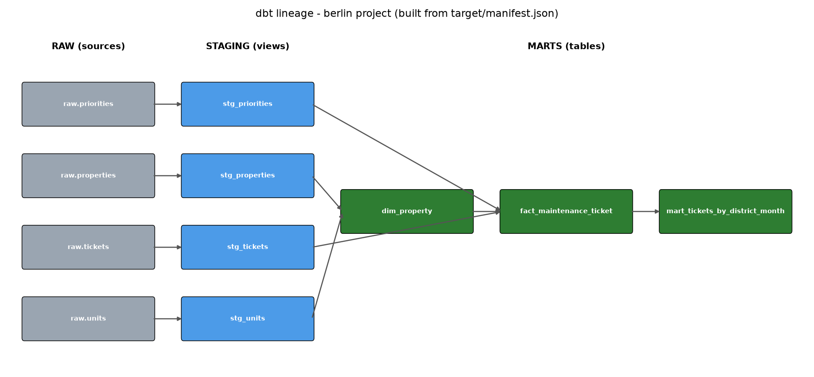

# dbt walkthrough – Berlin maintenance tickets (synthetic data)

This is a small but **real** dbt project. Everything in this file comes from commands that actually ran
on 24.10.2026. The full terminal output is saved in `outputs/`.
All data is synthetic – not real Optima/Emeria figures. Nothing here is uploaded anywhere.

> Note on times: dbt prints its log times in UTC. `06:40` in the logs = `08:40` Berlin time (UTC+2).

---

## 1. The big picture in one sentence

Raw data comes in messy → **staging** cleans it (one clean table per source) → **marts** combine the clean
tables and add business rules → Power BI reads only the marts. dbt builds all of it in the right order
and **tests** it.



The picture above (`outputs/lineage.png`) was drawn from dbt's own `target/manifest.json`, so it is
exactly the dependency graph dbt uses:

```
raw.tickets     -> stg_tickets     ─┐
raw.priorities  -> stg_priorities  ─┼─> fact_maintenance_ticket -> mart_tickets_by_district_month
raw.properties  -> stg_properties  ─┐│
raw.units       -> stg_units       ─┴┴> dim_property ──┘
```

---

## 2. Folder structure – what each file is

```
dbt_berlin/
├── dbt_project.yml              # project settings: name, folders, staging=view, marts=table
├── profiles.yml                 # WHERE to connect: the DuckDB file berlin.duckdb
├── berlin.duckdb                # the database (one file, like an .xlsx for SQL)
├── run_all.sh                   # rebuilds everything and saves the output
├── scripts/
│   ├── load_raw.py              # plays the "loading tool": CSV -> raw schema (+ deliberate mess)
│   ├── row_counts.py            # the counting queries in section 5
│   └── lineage.py               # draws outputs/lineage.png from manifest.json
├── macros/
│   └── generate_schema_name.sql # small tweak: schemas are called "staging" and "marts" exactly
├── models/
│   ├── staging/
│   │   ├── _sources.yml         # declares the raw tables, so we can write source('raw','tickets')
│   │   ├── _staging.yml         # descriptions + tests for staging models
│   │   ├── stg_tickets.sql
│   │   ├── stg_properties.sql
│   │   ├── stg_units.sql
│   │   └── stg_priorities.sql
│   └── marts/
│       ├── _marts.yml           # descriptions + tests for marts
│       ├── dim_property.sql
│       ├── fact_maintenance_ticket.sql
│       └── mart_tickets_by_district_month.sql
├── tests/
│   └── assert_ticket_resolved_after_created.sql   # a hand-written test (this one FAILS)
├── outputs/                     # the real terminal output of every command + lineage.png
└── target/                      # generated by dbt (compiled SQL, manifest.json, docs)
```

**Rule of thumb:** `.sql` files = *what* to build (each one becomes a table or view with the same name).
`.yml` files = *descriptions and tests* about those tables.

---

## 3. The raw layer (sources)

dbt does not load data. In a company a tool like Fivetran or a nightly export does that. Here
`scripts/load_raw.py` plays that role and copies 4 CSVs into a schema called `raw`:

```
raw.properties       680 rows
raw.units         33,000 rows
raw.priorities         4 rows
raw.tickets      149,769 rows
```

**Important – deliberate mess, for teaching only.** The Berlin CSVs were already fairly clean, so the
script makes `raw.tickets` messy *on purpose* so staging has real work to do:

| Mess added on purpose | How much |
|---|---|
| property ID in lowercase (`p001` instead of `P001`) | every 10th ticket (14,976 raw rows) |
| created date as German text (`19.06.2024 07:40`) | every 7th ticket (21,394 raw rows) |
| first 25 tickets exported twice | 25 duplicate rows |
| test tickets `TEST-001..003` for fake property `P999` | 3 junk rows |

One mess is **real** (not added): priorities come as `P1 Notfall`, `P2 Hoch` … – code and label in one field.

`models/staging/_sources.yml` tells dbt these tables exist:

```yaml
sources:
  - name: raw
    schema: raw
    tables:
      - name: tickets
      - name: properties
      ...
```

Now any model can write `{{ source('raw', 'tickets') }}` instead of a hard-coded table name.

---

## 4. Staging and marts – the SQL

### Staging: `models/staging/stg_tickets.sql` (cleaning only, no joins, no business rules)

```sql
with source as (
    select * from {{ source('raw', 'tickets') }}
),
cleaned as (
    select
        ticket_id,
        upper(property_id)                    as property_id,   -- 'p562' -> 'P562'
        unit_id,
        category,
        left(priority, 2)                     as priority,      -- 'P1 Notfall' -> 'P1'
        channel,
        contractor_id,
        coalesce(
            try_strptime(created_at, '%Y-%m-%d %H:%M:%S'),      -- ISO text
            try_strptime(created_at, '%d.%m.%Y %H:%M')          -- German text
        )                                     as created_at,
        try_cast(resolved_at as timestamp)    as resolved_at,
        status,
        status in ('Neu', 'In Bearbeitung', 'Wartet auf Material/Freigabe') as is_open,
        cast(cost_eur as decimal(12, 2))      as cost_eur
    from source
    where ticket_id not like 'TEST%'                            -- drop test tickets
)
select distinct * from cleaned                                  -- drop duplicate rows
```

Real before/after for one ticket (from `outputs/06_row_counts_and_samples.txt`):

| layer | ticket_id | property_id | priority | created_at |
|---|---|---|---|---|
| raw | MT000070 | p001 | P3 Normal | 19.06.2024 07:40 |
| staging | MT000070 | P001 | P3 | 2024-06-19 07:40:00 |

The other staging models are tiny: `stg_properties` and `stg_units` cast text to numbers/dates;
`stg_priorities` splits `P1 Notfall` into `priority = 'P1'` and `priority_label = 'Notfall'`.

### Mart: `models/marts/fact_maintenance_ticket.sql` (joins + business rule)

```sql
with tickets as (
    select * from {{ ref('stg_tickets') }}
),
priorities as (
    select * from {{ ref('stg_priorities') }}
),
properties as (
    select property_id, district, property_type from {{ ref('dim_property') }}
)
select
    t.ticket_id, t.property_id, p.district, p.property_type, t.unit_id, t.category,
    t.priority, pr.priority_label, t.status, t.is_open,
    t.created_at,
    cast(t.created_at as date)                       as created_date,
    date_trunc('month', t.created_at)::date          as created_month,
    t.resolved_at,
    round(date_diff('minute', t.created_at, t.resolved_at) / 60.0, 2) as resolution_hours,
    pr.sla_resolution_hours,
    case                                              -- BUSINESS RULE
        when t.resolved_at is null or t.status = 'Storniert' then null
        else date_diff('minute', t.created_at, t.resolved_at) / 60.0 <= pr.sla_resolution_hours
    end                                               as met_resolution_sla,
    t.cost_eur
from tickets t
left join priorities pr using (priority)
left join properties p  using (property_id)
```

`ref('stg_tickets')` is how dbt learns the order: it sees this model needs `stg_tickets`,
`stg_priorities` and `dim_property`, so it builds those first.

The other marts:
- `dim_property` = clean properties + number of units and total m² per property (joins `stg_units`).
- `mart_tickets_by_district_month` = one row per district per month: tickets, open tickets,
  SLA rate and cost. 528 rows – ready for a Power BI line chart.

---

## 5. Row counts: raw vs staging vs marts (real query results)

| table | rows | what happened |
|---|---|---|
| raw.tickets | 149,769 | messy export |
| staging.stg_tickets | 149,741 | −3 TEST rows, −25 duplicates = −28 |
| marts.fact_maintenance_ticket | 149,741 | same grain (one row per ticket), more columns |
| raw.properties / stg_properties / dim_property | 680 / 680 / 680 | |
| raw.units / stg_units | 33,000 / 33,000 | used inside dim_property |
| raw.priorities / stg_priorities | 4 / 4 | |
| marts.mart_tickets_by_district_month | 528 | aggregated: 16 districts × 33 months |

After staging: lowercase property IDs left = **0**.

Business rule in action – resolution SLA rate by priority (from the mart):

| priority | label | measured tickets | SLA rate |
|---|---|---|---|
| P1 | Notfall | 8,018 | 0.847 |
| P2 | Hoch | 38,731 | 0.803 |
| P3 | Normal | 74,476 | 0.855 |
| P4 | Niedrig | 22,645 | 0.880 |

(These are very close to the Power BI page: 84.6 / 80.2 / 85.5 / 88.0 %. The small differences come from
the 190 broken-timestamp tickets this simple rule still counts. Excluding them gives exactly
0.846 / 0.802 / 0.855 / 0.880, which I checked with a query. See the failing test below.)

Sample of `mart_tickets_by_district_month` (Mitte, 2026, some columns):

| district | month | tickets | open | met SLA | SLA rate | cost € |
|---|---|---|---|---|---|---|
| Mitte | 2026-01 | 389 | 4 | 288 | 0.756 | 212,516.39 |
| Mitte | 2026-02 | 372 | 6 | 286 | 0.790 | 169,088.35 |
| Mitte | 2026-03 | 325 | 5 | 257 | 0.824 | 147,692.11 |
| … | | | | | | |
| Mitte | 2026-09 | 275 | 62 | 184 | 0.880 | 91,998.48 |

---

## 6. The commands – what each one did (real output)

All commands run with `DBT_PROFILES_DIR=<repo>/dbt_berlin` so dbt finds `profiles.yml` in the project.

### `dbt debug` – "can I connect?" (`outputs/01_dbt_debug.txt`)
Checks the project file, the profile and the database connection. Nothing is built.
```
Using profiles.yml file at <repo>/dbt_berlin/profiles.yml
adapter type: duckdb
  Connection test: [OK connection ok]
All checks passed!
```

### `dbt run` – build all models (`outputs/02_dbt_run.txt`)
Notice the order: the 4 staging views first (in parallel), then `dim_property`, then the fact,
then the aggregate. dbt worked this out from the `ref()`s.
```
Found 7 models, 21 data tests, 4 sources, 501 macros
1 of 7 OK created sql view model staging.stg_priorities ........ [OK in 0.12s]
...
5 of 7 OK created sql table model marts.dim_property ........... [OK in 0.05s]
6 of 7 OK created sql table model marts.fact_maintenance_ticket  [OK in 0.27s]
7 of 7 OK created sql table model marts.mart_tickets_by_district_month [OK in 0.02s]
Finished running 3 table models, 4 view models ...
Done. PASS=7 WARN=0 ERROR=0 SKIP=0 NO-OP=0 REUSED=0 TOTAL=7
```

### `dbt test` – check every rule (`outputs/03_dbt_test.txt`)
21 tests: `unique`, `not_null`, `accepted_values` (priority P1–P4), `relationships`
(ticket property_id → dim_property), and one hand-written test.
```
PASS unique_stg_tickets_ticket_id
PASS accepted_values_stg_tickets_priority__P1__P2__P3__P4
PASS relationships_fact_maintenance_ticket_property_id__property_id__ref_dim_property_
FAIL 190 assert_ticket_resolved_after_created .......... [FAIL 190 in 0.10s]
...
Completed with 1 error, 0 partial successes, and 0 warnings:
[ERROR]: in test assert_ticket_resolved_after_created (tests/assert_ticket_resolved_after_created.sql)
  Got 190 results, configured to fail if != 0
Done. PASS=20 WARN=0 ERROR=1 SKIP=0 NO-OP=0 REUSED=0 TOTAL=21
```

### `dbt build` – run + test, model by model (`outputs/04_dbt_build.txt`)
`build` tests each model right after building it. When a test fails, everything *downstream* of
that model is **skipped**, so bad data never reaches the next layer:
```
22 of 28 FAIL 190 assert_ticket_resolved_after_created ........ [FAIL 190 in 0.06s]
26 of 28 SKIP relation marts.mart_tickets_by_district_month .... [SKIP]
27 of 28 SKIP test not_null_mart_tickets_by_district_month_created_month [SKIP]
28 of 28 SKIP test not_null_mart_tickets_by_district_month_district [SKIP]
Done. PASS=24 WARN=0 ERROR=1 SKIP=3 NO-OP=0 REUSED=0 TOTAL=28
```
This is the key difference between `run` and `build`: with `run` the aggregate was built anyway;
with `build` dbt protected it. (28 = 7 models + 21 tests.)

### `dbt docs generate` (`outputs/05_dbt_docs_generate.txt`)
Writes `target/catalog.json` + `manifest.json` with all descriptions from the `.yml` files.
`dbt docs serve` would open it as a website with a clickable lineage graph (not run here – local only).

---

## 7. The failing test – why, and how to fix it

`tests/assert_ticket_resolved_after_created.sql`:
```sql
select ticket_id, created_at, resolved_at
from {{ ref('fact_maintenance_ticket') }}
where resolved_at < created_at
```
A singular test is just a query that looks for **bad rows**. 0 rows = PASS, any rows = FAIL.

**Why it fails:** 190 tickets in the source data really are "resolved before they were created"
(this is genuine in the data, not one of the mistakes I added). Real examples:

| ticket_id | created_at | resolved_at | resolution_hours |
|---|---|---|---|
| MT000111 | 2024-09-18 23:05 | 2024-09-18 11:05 | −12.0 |
| MT000181 | 2025-01-29 22:23 | 2025-01-29 10:23 | −12.0 |
| MT000760 | 2025-05-19 14:21 | 2025-05-18 09:21 | −29.0 |

The gaps vary (from about −2 h to −50 h), so it looks like data entry or system errors, not one fixed timezone shift.
Consequence: negative resolution hours count as "met SLA", which flatters the KPI.

**How you would fix it (pick one, in this order of preference):**
1. **Fix at the source** – ask the ticket-system owner to correct the timestamps. Best, but slowest.
2. **Handle it in staging** – e.g. in `stg_tickets` add
   `resolved_at < created_at as dq_ts_invalid` and set `resolved_at` to `null` for those rows, so they
   are excluded from SLA. The test then passes and the problem stays visible as a flag.
3. **Downgrade to a warning** while it is being fixed: add `{{ config(severity='warn') }}` at the top
   of the test. dbt then shows `WARN 190` instead of `FAIL`, and `build` no longer skips downstream models.

It is left failing on purpose so you can see what a FAIL looks like.

---

## 8. How this maps to your Power BI project

| Berlin Power BI project | dbt |
|---|---|
| Excel / CSV sheets | sources (`raw` schema) |
| Fixing types in Power Query (`statement_id` problem) | staging models |
| `dim_` / `fact_` / `mart_` tables | mart models |
| Data Quality page (12 checks) | `dbt test` |
| Relationships in the model view | `relationships` tests |

---

## 9. Rebuild it yourself

```bash
cd <repo>/dbt_berlin
source .venv/bin/activate
export DBT_PROFILES_DIR=$PWD
python scripts/load_raw.py   # raw layer
dbt debug
dbt run
dbt test
dbt build
# or everything at once:
./run_all.sh
```
Versions used: dbt-core 1.12.6, dbt-duckdb 1.11.0, Python 3.13.5.
